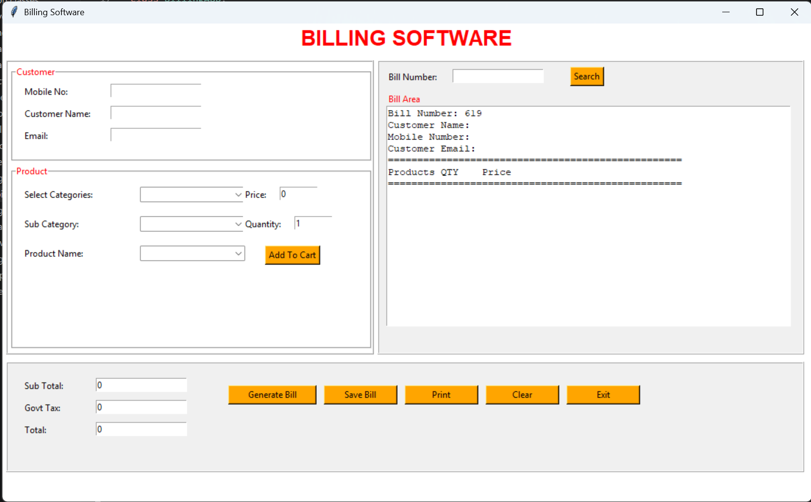
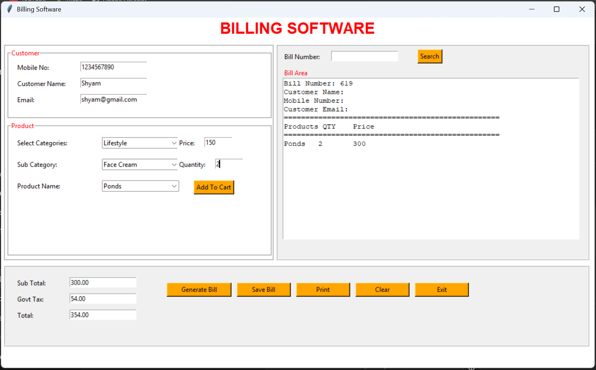
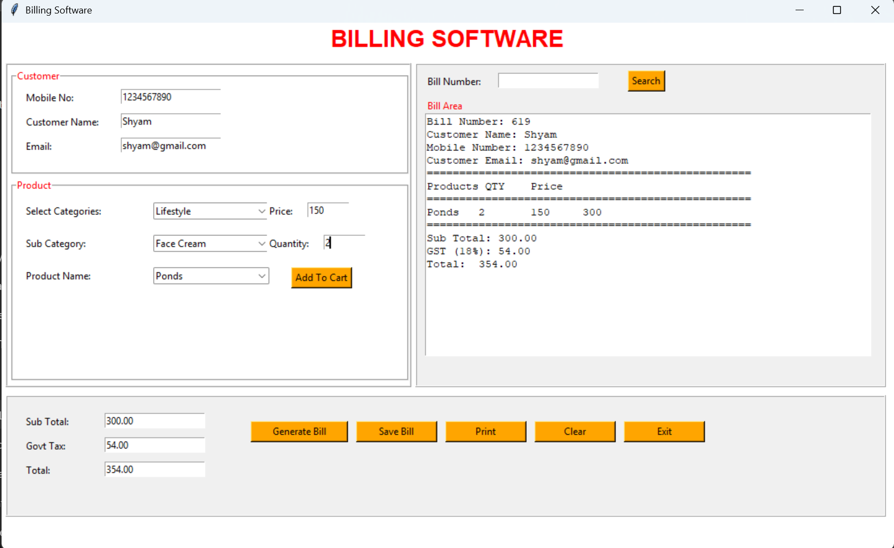

# 🧾 Billing System (Python)

A simple desktop billing system built using Python and Tkinter to generate invoices, manage items, and calculate totals with GST.

---

## 🚀 Features

* Add products to cart
* Automatic subtotal, GST, and total calculation
* Generate formatted bill
* Save bill to database (MySQL)
* Search previous bills
* Print bill functionality
* Clean and user-friendly UI

---

## 🛠 Tech Stack

* Python
* Tkinter (GUI)
* MySQL (Database)
* PyMySQL

---

## 📸 Screenshots

### 🖥 Main Interface



### ➕ Adding Items to Cart



### 🧾 Generated Bill



---

## ▶️ Run Locally

```bash
pip install -r requirements.txt
python bill.py
```

---

## ⚠️ Note

Database credentials are not included in this repository for security reasons.

Make sure to configure your own database connection before running the project.
